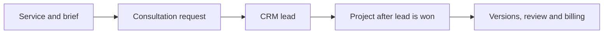

<h1 align="center">
  
</h1>

  <strong>The studio website and production workspace for Admakai, a Dhaka-based AI advertising agency.</strong>

  <a href="https://admakai.com/"><strong>Live website</strong></a> ·
  <a href="#website-and-portfolio">Website</a> ·
  <a href="#booking-and-production">Production</a> ·
  <a href="#careers-and-hiring">Hiring</a> ·
  <a href="#architecture">Architecture</a> ·
  <a href="#technology">Stack</a>

## Project overview

Admakai combines creative direction, generative media and post-production for commercials, product films, AI UGC and social campaigns. The website presents the studio's work and services, helps prospective clients choose a production format and connects enquiries to the studio's booking and sales workflow. The same codebase supports staff production tools and a hiring pipeline. Admakai is a Branta Tech sister concern. [About Admakai](https://admakai.com/about)

| Audience | What the application supports |
| --- | --- |
| Prospective clients | Browse services and past work, compare project and monthly pricing, and submit a brief with a consultation request. |
| Signed-in users | Manage their profile, view their own calls, access call attachments, follow job applications and download documents available to them. |
| Studio staff | Manage bookings, leads, project tasks, deliverable versions, feedback, billing, portfolio publishing and offers. |
| Hiring staff and members | Publish roles, review applications, coordinate interviews and manage the journey from onboarding to milestones and letters. |

## Website and portfolio

| Experience | Implementation |
| --- | --- |
| [Home](https://admakai.com/) | The motion-led homepage brings together the showreel, production capabilities, recent work, client logos, monthly plans and FAQs. [Home route](src/routes/_site.index.tsx) |
| [Services](https://admakai.com/services) | Browse published services by category or goal and use the browser-based finder to narrow down the right format. Individual pages show deliverables, use cases, estimates, relevant work and a booking link that carries the selected service. [Services route](src/routes/_site.services.tsx) · [Service finder](src/components/ServiceFinder.tsx) |
| [Work](https://admakai.com/work) | Search and filter published projects. Detail pages combine video, credits or case-study content, related work and public feedback. Vimeo metadata and thumbnails support the portfolio, and staff moderate comments. [Portfolio route](src/routes/_site.work.index.tsx) · [Work detail](src/components/public/WorkDetailPage.tsx) |
| [Pricing](https://admakai.com/pricing) | Project ranges and monthly plans share catalogue data with the homepage. Currency display uses cached exchange rates and fallback values. Scheduled offers use a single winning rule for each eligible display price and keep base prices in the catalogue. [Pricing route](src/routes/_site.pricing.tsx) · [Currency](src/lib/currency.tsx) · [Offer rules](src/lib/offer-rules.ts) |
| [Blog](https://admakai.com/blog) | The Bangla editorial pages cover how the Sazdah TVC was made and include a video lighting guide with examples and prompts. [Sazdah case study](https://admakai.com/blog/sazdah-tvc) · [Lighting guide](https://admakai.com/blog/video-lighting-guide) |

### Design and media

The public site uses Admakai's white wordmark, charcoal surfaces and editorial serif headings. The dashboard and staff console use a light palette. The README cover combines the original wordmark, the site's showreel artwork and Shahriar Nabil's developer mark. [Design tokens](src/styles.css) · [Brand assets](public/brand)

Shared video previews coordinate playback across cards. Vimeo lightboxes, poster imagery and responsive video sources support the public portfolio. Motion components use Framer Motion, GSAP and Lenis with reduced-motion handling in the relevant interactions. [Video preview card](src/components/VideoPreviewCard.tsx) · [Vimeo player](src/components/services/VimeoPlayer.tsx) · [Motion components](src/components/motion)

## Booking and production

1. **Request a consultation.** The form carries the selected service or monthly plan, presents database-generated times in Dhaka time and validates contact and brief details. PostgreSQL checks slot availability and links the booking to a contact and lead. [Book a call](https://admakai.com/book) · [Booking UI](src/components/public/SlotBookingPage.tsx) · [Booking API](src/lib/booking-api.ts)
2. **Qualify the lead.** Staff can assign a host, review the brief and attachments, update meeting details and shared notes, and move opportunities through the sales pipeline. A database trigger creates a linked project when a lead is marked won. [Staff console](src/components/admin/AdminPage.tsx) · [CRM migrations](supabase/migrations)
3. **Produce and review.** The project workspace tracks brief, script, assets, first cut, revision, final and delivery stages. Staff assign tasks, upload versions, open private delivery media and resolve timecoded comments. The review component also includes client-side approval and change-request logic. [Projects workspace](src/components/delivery/ProjectsWorkspace.tsx) · [Review player](src/components/delivery/ReviewPlayer.tsx)
4. **Track billing.** Staff prepare invoices, manage line items, record payments, and print or save invoice PDFs. Database rules track numbering, totals and payment status. [Billing workspace](src/components/admin/Billing.tsx) · [Billing rules](src/lib/billing.ts)

## Account and client workspace

- **Sign-in.** The public flow uses Supabase Auth with email codes, email and password, recovery and Google where enabled. Legacy account paths resolve to the shared dashboard. Staff sign in through Branta Hub using a state-checked callback. [Sign-in route](src/routes/signin.tsx) · [Account routing](src/lib/account-rules.ts) · [Staff SSO](src/lib/sso.ts)
- **Calls and uploads.** A verified account can see its linked bookings, shared notes and eligible meeting links. The file flow checks booking ownership and uses signed transfers for private files. [Calls dashboard](src/routes/dashboard.calls.tsx) · [Client functions](src/lib/client.functions.ts)
- **My account.** The dashboard consolidates a user's calls, applications, documents, profile and eligible member journey. Search and updates draw from the signed-in user's own records. [Dashboard](src/routes/dashboard.tsx) · [Account data](src/components/account/useAccount.ts)

## Careers and hiring

| Stage | What the application supports |
| --- | --- |
| Discover and save roles | Public job board with filters and job details, saved roles for signed-in users and a talent-pool form. [Careers](https://admakai.com/careers) · [Careers functions](src/lib/careers.functions.ts) |
| Apply | Job-specific application steps, saved drafts, configurable questions, résumé and document uploads, optional practical tasks and a signed declaration. [Application wizard](src/components/careers/ApplicationPage.tsx) · [Application server](src/lib/application.functions.ts) |
| Review and interview | A staff board supports application stages, reviewer assignment, scores, internal notes and candidate-visible updates. Staff can schedule, reschedule and record interview outcomes. Assigned interviewer access is scoped. [Review workspace](src/components/admin/hiring/Applications.tsx) · [Review functions](src/lib/hiring-review.functions.ts) |
| Deliver documents | Signed agreements are generated from versioned inputs and retained as immutable originals. Document versions, letters and branded email use a delivery outbox with delivery status and retry handling. [Declaration PDF](src/lib/declaration-pdf.server.ts) · [Delivery outbox](src/lib/outbox.server.ts) |
| Follow a member journey | Eligible members can see their stage and milestones. Staff can assign mentors, record milestone progress, track projects and issue offer or completion letters from versioned templates. [Journey functions](src/lib/hiring-journey.functions.ts) · [Member route](src/routes/dashboard.journey.tsx) |

## Staff console

| Workspace | Staff tools |
| --- | --- |
| Bookings and sales | Consultations, assignment, follow-up, lead stages, sales estimates and activity. |
| Projects and billing | Production stages, task ownership, versioned media, timecoded feedback, invoices and payment records. |
| Publishing | Portfolio, work categories, service mappings, featured projects, import and export, service catalogue and monthly plans. |
| Campaigns and analytics | Schedule and target offers, attribute related enquiries and bookings, review event totals and conversion steps, and moderate portfolio feedback. |
| Hiring | Openings, question bank, application and interview queues, declaration and letter templates, email delivery and member journeys. |

[Admin routes](src/routes) · [Catalogue editing](src/lib/site-content.functions.ts) · [Offers](src/lib/offers.functions.ts) · [Analytics](src/components/admin/analytics/AnalyticsAdmin.tsx)

## Architecture

- **Web application.** TanStack Start and Router serve the public site and server functions. TanStack Query supports route loading and refresh. Vite and Nitro supply the build and server runtime. The configuration selects About and Work for prerendering and serves editable catalogue and pricing routes on request. [Vite configuration](vite.config.ts) · [Server entry](src/server.ts) · [Public route rules](src/data/seo-routes.ts)
- **Data and permissions.** Supabase provides PostgreSQL, Auth, Storage and Realtime. RLS, role checks and ownership checks control access to staff, client and applicant records. Browser queries use the publishable client. Privileged work runs through server functions and database RPCs. [Supabase integration](src/integrations/supabase) · [Migrations](supabase/migrations)
- **Delivery and communication.** Supabase Storage holds private uploads and documents with signed access. Resend supports booking and hiring notifications. The delivery outbox tracks processing and retries for queued email and PDF work. [Client file operations](src/lib/client.functions.ts) · [Hiring delivery](src/lib/hiring-delivery.server.ts) · [Booking notifications](src/lib/crm-emails.server.ts)
- **Discoverability.** Route-level metadata includes canonical URLs, Open Graph and language settings. Structured data describes the studio, services, work, articles, FAQs and eligible job pages. The build-time sitemap combines static routes and published records when public data is available. [SEO helpers](src/lib/seo.ts) · [Sitemap generator](scripts/sitemap.ts)

## Technology

Versions come from [`bun.lock`](bun.lock). The manifest contains 68 application dependencies and 23 development dependencies.

| Layer | Technology |
| --- | --- |
| Application and routing | TanStack Start `1.168.60`, TanStack Router `1.170.41`, TanStack Query `5.101.4`, React and React DOM `19.2.8` |
| Build and runtime | TypeScript `5.9.3`, Vite `8.1.5`, Nitro `3.0.260603-beta`, Bun lockfile |
| Data and identity | Supabase JS `2.118.0`, PostgreSQL, Auth, Storage, Realtime, RLS and Branta Hub SSO |
| Design and motion | Tailwind CSS `4.3.3`, Radix UI, Framer Motion `14.6.0`, GSAP `3.15.0`, Lenis `1.3.27` and Lucide React `0.575.0` |
| Media and documents | Vimeo Player `2.30.4`, pdf-lib `1.17.1`, Signature Pad `5.1.4`, QRCode `1.5.4` and write-excel-file `4.1.1` |
| Forms and tests | React Hook Form `7.83.0`, Zod `3.25.76`, libphonenumber-js `1.13.15`, Vitest `4.1.11` and Testing Library React `16.3.3` |

All locked direct dependencies

| Package | Locked version | Group |
| --- | --- | --- |
| `@hookform/resolvers` | `5.5.7` | Application |
| `@pdf-lib/fontkit` | `1.1.1` | Application |
| `@radix-ui/react-accordion` | `1.2.20` | Application |
| `@radix-ui/react-alert-dialog` | `1.1.23` | Application |
| `@radix-ui/react-aspect-ratio` | `1.1.15` | Application |
| `@radix-ui/react-avatar` | `1.2.6` | Application |
| `@radix-ui/react-checkbox` | `1.3.11` | Application |
| `@radix-ui/react-collapsible` | `1.1.20` | Application |
| `@radix-ui/react-context-menu` | `2.3.7` | Application |
| `@radix-ui/react-dialog` | `1.1.23` | Application |
| `@radix-ui/react-dropdown-menu` | `2.1.24` | Application |
| `@radix-ui/react-hover-card` | `1.1.23` | Application |
| `@radix-ui/react-label` | `2.1.15` | Application |
| `@radix-ui/react-menubar` | `1.1.24` | Application |
| `@radix-ui/react-navigation-menu` | `1.2.22` | Application |
| `@radix-ui/react-popover` | `1.1.23` | Application |
| `@radix-ui/react-progress` | `1.1.16` | Application |
| `@radix-ui/react-radio-group` | `1.4.7` | Application |
| `@radix-ui/react-scroll-area` | `1.2.18` | Application |
| `@radix-ui/react-select` | `2.3.7` | Application |
| `@radix-ui/react-separator` | `1.1.15` | Application |
| `@radix-ui/react-slider` | `1.4.7` | Application |
| `@radix-ui/react-slot` | `1.3.3` | Application |
| `@radix-ui/react-switch` | `1.3.7` | Application |
| `@radix-ui/react-tabs` | `1.1.21` | Application |
| `@radix-ui/react-toggle` | `1.1.18` | Application |
| `@radix-ui/react-toggle-group` | `1.1.19` | Application |
| `@radix-ui/react-tooltip` | `1.2.16` | Application |
| `@supabase/supabase-js` | `2.118.0` | Application |
| `@tailwindcss/vite` | `4.3.3` | Application |
| `@tanstack/react-query` | `5.101.4` | Application |
| `@tanstack/react-router` | `1.170.41` | Application |
| `@tanstack/react-start` | `1.168.60` | Application |
| `@tanstack/router-plugin` | `1.168.42` | Application |
| `@tanstack/zod-adapter` | `1.167.0` | Application |
| `@vimeo/player` | `2.30.4` | Application |
| `class-variance-authority` | `0.7.1` | Application |
| `clsx` | `2.1.1` | Application |
| `cmdk` | `1.1.1` | Application |
| `country-flag-icons` | `1.6.20` | Application |
| `date-fns` | `4.4.0` | Application |
| `embla-carousel-react` | `8.6.0` | Application |
| `fast-png` | `8.0.0` | Application |
| `framer-motion` | `14.6.0` | Application |
| `gsap` | `3.15.0` | Application |
| `input-otp` | `1.4.2` | Application |
| `lenis` | `1.3.27` | Application |
| `libphonenumber-js` | `1.13.15` | Application |
| `lucide-react` | `0.575.0` | Application |
| `pdf-lib` | `1.17.1` | Application |
| `qrcode` | `1.5.4` | Application |
| `react` | `19.2.8` | Application |
| `react-day-picker` | `9.14.0` | Application |
| `react-dom` | `19.2.8` | Application |
| `react-easy-crop` | `6.2.4` | Application |
| `react-hook-form` | `7.83.0` | Application |
| `react-markdown` | `10.1.0` | Application |
| `react-resizable-panels` | `4.12.2` | Application |
| `recharts` | `2.15.4` | Application |
| `signature_pad` | `5.1.4` | Application |
| `sonner` | `2.0.7` | Application |
| `tailwind-merge` | `3.6.0` | Application |
| `tailwindcss` | `4.3.3` | Application |
| `tw-animate-css` | `1.4.0` | Application |
| `vaul` | `1.1.2` | Application |
| `vite-tsconfig-paths` | `6.1.1` | Application |
| `write-excel-file` | `4.1.1` | Application |
| `zod` | `3.25.76` | Application |
| `@eslint/js` | `9.39.5` | Development |
| `@tanstack/devtools-vite` | `0.8.3` | Development |
| `@testing-library/jest-dom` | `6.10.0` | Development |
| `@testing-library/react` | `16.3.3` | Development |
| `@types/node` | `22.20.1` | Development |
| `@types/qrcode` | `1.5.6` | Development |
| `@types/react` | `19.2.17` | Development |
| `@types/react-dom` | `19.2.3` | Development |
| `@types/vimeo__player` | `2.18.3` | Development |
| `@vitejs/plugin-react` | `5.2.0` | Development |
| `eslint` | `9.39.5` | Development |
| `eslint-config-prettier` | `10.1.8` | Development |
| `eslint-plugin-prettier` | `5.5.6` | Development |
| `eslint-plugin-react-hooks` | `5.2.0` | Development |
| `eslint-plugin-react-refresh` | `0.4.26` | Development |
| `globals` | `15.15.0` | Development |
| `jsdom` | `20.0.3` | Development |
| `nitro` | `3.0.260603-beta` | Development |
| `prettier` | `3.9.6` | Development |
| `typescript` | `5.9.3` | Development |
| `typescript-eslint` | `8.65.0` | Development |
| `vite` | `8.1.5` | Development |
| `vitest` | `4.1.11` | Development |

## Repository guide

| Path | Contents |
| --- | --- |
| [`src/routes/`](src/routes) | Public site, account dashboard, sign-in, staff screens and server routes. |
| [`src/components/`](src/components) | Website, media, booking, dashboard, client, delivery and hiring interfaces. |
| [`src/data/`](src/data) and [`src/content/`](src/content) | Service catalogue fallbacks, editorial content, portfolio data and media definitions. |
| [`src/lib/`](src/lib) | Business rules, server functions, authentication, SEO, PDF rendering and delivery. |
| [`supabase/migrations/`](supabase/migrations) | Schema, access policies, database functions and migration history. |
| [`public/`](public) and [`docs/readme/`](docs/readme) | Brand assets, site media and the case-study cover. |

## Credits

  

**Shahriar Nabil** · [Portfolio](https://shahnabil.com/) · [GitHub](https://github.com/ShahNabil1)

**Admakai** · [Studio website](https://admakai.com/) · [Branta Tech](https://brantatech.com/)

[Privacy policy](https://admakai.com/privacy) · [Terms of service](https://admakai.com/terms) · [Refund policy](https://admakai.com/refund)
